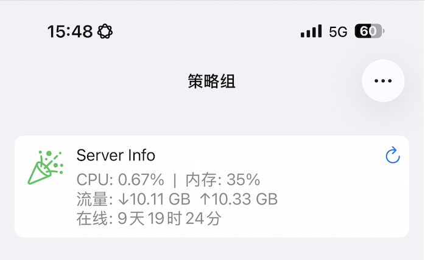

## 🚀 VPS 监控面板

基于 **Go 后端 + Docker + Surge Panel** 的轻量级原生服务器指标监控方案。

<p align="left">
  
</p>

### ✨ 项目特点

- 无需数据库
- 无需 Docker Socket 权限
- 无需额外 Agent
- 基于 Linux 原生 `/proc` 数据源
- Docker 一键部署
- 支持 Surge 图形化参数配置
- 支持多服务器部署
- 资源占用极低

### 1. 服务端部署（VPS）

在 Linux 服务器上新建目录（推荐 `/opt/docker/secure-monitor`），创建 `docker-compose.yml` 文件并写入以下配置：

```yaml
services:
  secure-monitor:
    image: hk2fs/secure-monitor:v2.0
    container_name: secure-monitor
    restart: always

    network_mode: host
    read_only: true

    security_opt:
      - no-new-privileges:true

    environment:
      - API_KEY=<填入你生成的随机密钥>
      - PORT=40728 # 可自定义监听端口

    volumes:
      - /proc:/host/proc:ro
      - /sys:/host/sys:ro
```

启动服务：

```bash
docker compose up -d
```

生成随机 API Key（推荐）：

```bash
openssl rand -hex 32
```

将生成的随机字符串填入 Docker Compose 配置中的 `API_KEY`，并在 Surge 模块参数中填写相同的值即可完成认证。

`PORT` 可根据实际需求修改，但需确保：

- Surge 模块中的后端地址同步修改
- 服务器安全组放行对应端口
- 本机防火墙允许对应端口访问

💡 启动后请记得在云服务器控制台（安全组 / 防火墙）中放行对应 TCP 端口。

### 2. 客户端配置（Surge）

1. 打开 Surge
2. 进入 **模块（Modules）**
3. 点击 **安装新模块**
4. 导入以下链接：

```text
https://raw.githubusercontent.com/vplkos/jovery/main/modules/vps_monitor.sgmodule
```

5. 安装完成后，点击模块右侧 **···**
6. 选择 **编辑参数**

| 参数 | 说明 |
|--------|--------|
| 后端地址 | 服务器 IP 与端口 |
| 鉴权密钥 | Docker 配置中的 API_KEY |
| 面板标题 | 自定义服务器名称 |
| 面板图标 | SF Symbols 图标名称 |
| 刷新间隔 | 建议 15～30 秒 |

配置保存并重载后，即可在 Surge 首页查看服务器实时状态。

### 📊 监控指标

当前支持以下监控项目：

- CPU 使用率
- 内存使用率
- 网络总流量
- 系统运行时间

所有数据均直接读取 Linux 宿主机内核接口，不依赖 Docker API、SNMP 或第三方监控 Agent。

<details>
<summary>🔬 实现原理</summary>

| 监控项目 | 数据来源 | 计算方式 |
| --- | --- | --- |
| CPU 使用率 | `/proc/stat` | 基于 `/proc/stat` 差分采样计算 |
| 内存使用率 | `/proc/meminfo` | 基于 `MemAvailable` 计算真实内存占用率 |
| 网络总流量 | `/proc/net/dev` | 汇总所有非回环网卡流量 |
| 系统运行时间 | `/proc/uptime` | 读取系统启动时间 |

</details>

